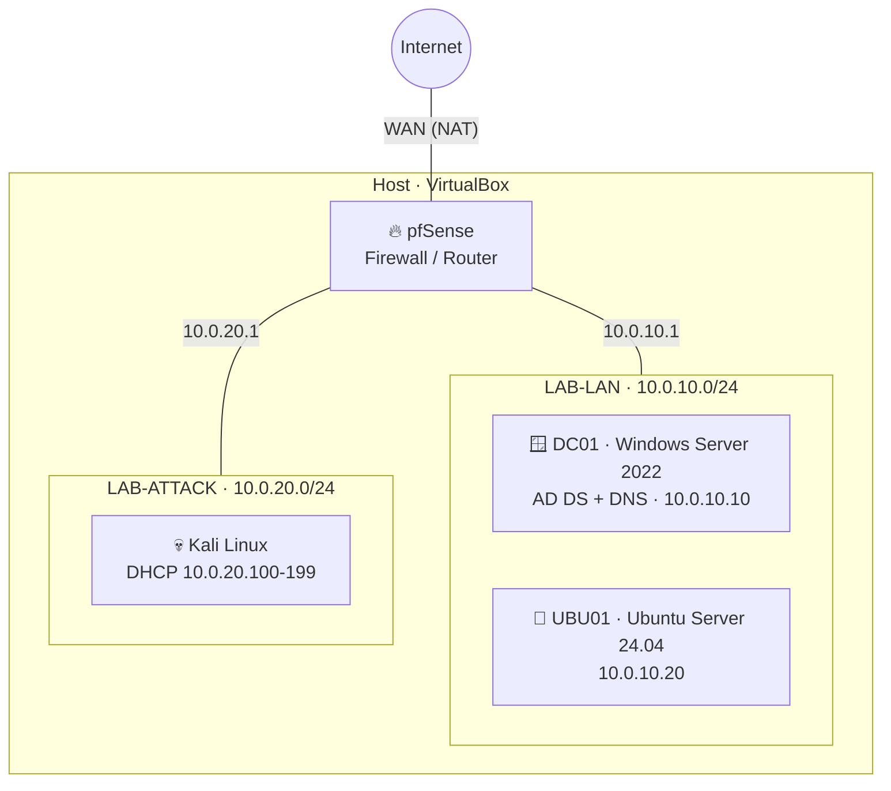

# 🛡️ Cybersecurity Home Lab

> **Status:** 🚧 In progress

A virtualised small-business network that I am designing and building myself to get hands-on experience with network security, Active Directory administration, and offensive and defensive security.

## 🗺️ Architecture

| Host | OS | Network | IP | Role |
|---|---|---|---|---|
| pfSense | pfSense CE | WAN / LAN / ATTACK | DHCP / 10.0.10.1 / 10.0.20.1 | Firewall, router, DHCP |
| DC01 | Windows Server 2022 | LAB-LAN | 10.0.10.10 | Domain controller, DNS (`lab.internal`) |
| UBU01 | Ubuntu Server 24.04 | LAB-LAN | 10.0.10.20 | Domain-joined Linux server |
| Kali | Kali Linux | LAB-ATTACK | DHCP | Attacker machine |

## 🧩 Design decisions
- **Separate attacker network.** Kali sits on its own network behind the firewall, so it can only reach what the firewall rules allow, much like an attacker outside a company's internal network.
- **Firewall management interface protected.** Traffic from the attacker network to the firewall itself is blocked, so the management interface can't be reached from there.
- **`.internal` domain.** `.internal` is the top-level domain reserved for private networks, which avoids the mDNS clashes that `.local` causes on Linux clients.
- **Scripted AD setup.** OUs, groups and users are created with an idempotent PowerShell script ([`scripts/create-users.ps1`](scripts/create-users.ps1)), so the domain can be rebuilt the same way every time.

## 📈 Progress

| Phase | Description | Status |
|---|---|---|
| 1 | Network and firewall segmentation (pfSense) | 🔲 Planned |
| 2 | Active Directory domain: OUs, groups, users | 🔲 Planned |
| 3 | Ubuntu server joined to the domain (SSSD / Kerberos) | 🔲 Planned |
| 4 | Validation and reconnaissance from the attacker network | 🔲 Planned |
| 5 | Wazuh SIEM with agents on DC01 and UBU01 | 🔲 Planned |
| 6 | Simulate AD attacks (Kerberoasting, password spraying) and detect them in Wazuh | 🔲 Planned |

## 🧠 Lessons learned
*Updated as each phase is completed.*

## 📸 Screenshots
*Added as each phase is completed.*
