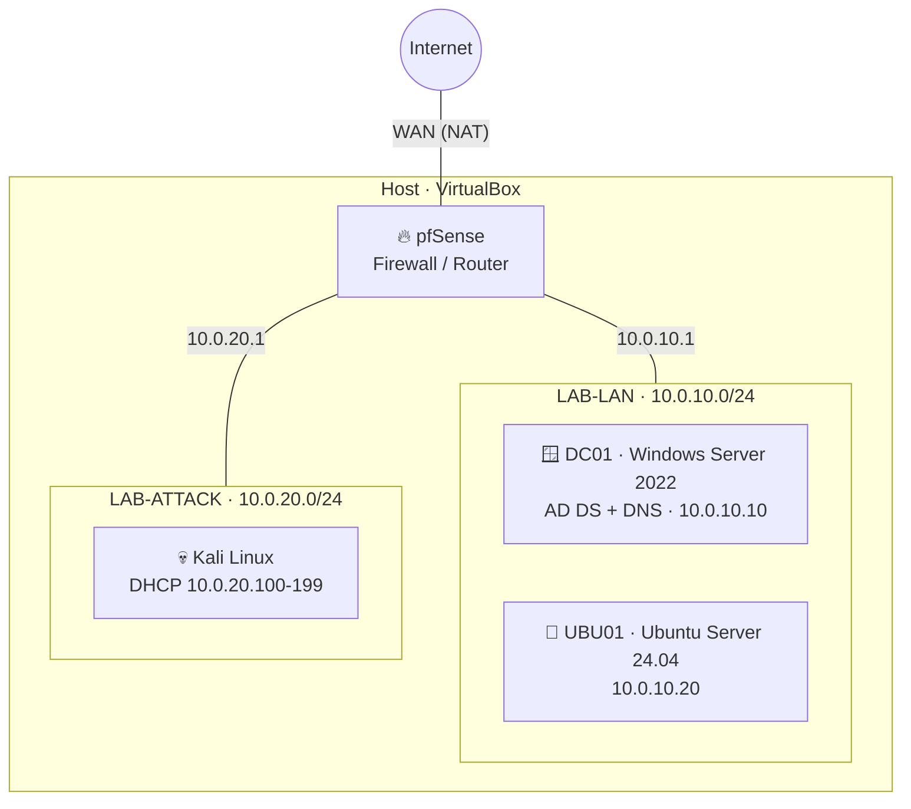

# 🛡️ Cybersecurity Home Lab

A virtual environment for practising network administration, Active Directory, attack and defence.
It simulates a small company network: a firewall, a domain controller, a Linux server, and an attacker machine on a separate network.

## 🎯 Goals
- Set up a firewall that splits the lab into separate networks (pfSense)
- Build an Active Directory domain with users, groups and OUs
- Join a Linux server to the domain
- Test the network from an isolated attacker machine (Kali)
- Lay the groundwork for the next projects: a SIEM (Wazuh) and detecting attacks on Active Directory

## 🗺️ Architecture

## 📋 IP addressing plan

| Machine | OS | Network | IP | Role |
|---|---|---|---|---|
| pfSense | pfSense CE | WAN / LAN / ATTACK | DHCP / 10.0.10.1 / 10.0.20.1 | Firewall, router, DHCP |
| DC01 | Windows Server 2022 | LAB-LAN | 10.0.10.10 | Domain controller, DNS |
| UBU01 | Ubuntu Server 24.04 | LAB-LAN | 10.0.10.20 | Domain-joined Linux server |
| Kali | Kali Linux | LAB-ATTACK | DHCP | Attacker machine |

**Domain:** `lab.internal` (NetBIOS name `LAB`). It uses `.internal` because that top-level domain is reserved for private networks. `.local` would clash with mDNS on Linux.

## 💻 Requirements
- A CPU with virtualisation enabled in the BIOS (VT-x / AMD-V)
- **16 GB of RAM** (the 4 VMs use about 11 GB)
- About 150 GB of free disk space
- [VirtualBox](https://www.virtualbox.org/) (VMware Workstation, which is now free, also works)

| VM | vCPU | RAM | Disk |
|---|---|---|---|
| pfSense | 1 | 1 GB | 16 GB |
| DC01 | 2 | 4 GB | 60 GB |
| UBU01 | 1 | 2 GB | 25 GB |
| Kali | 2 | 4 GB | 80 GB |

## 🛠️ Build guide
1. [pfSense: firewall and network segmentation](docs/01-pfsense.md)
2. [Windows Server: Active Directory](docs/02-windows-ad.md)
3. [Ubuntu Server: joining the domain](docs/03-ubuntu.md)
4. [Kali: validation and first tests](docs/04-kali-validation.md)

> 💡 Take a **snapshot** of each VM at the end of every step. If something breaks, you can roll back in seconds.

## ✅ Roadmap
- [ ] Network and firewall with separate LAN and attacker networks
- [ ] AD domain with users and groups
- [ ] Ubuntu joined to the domain
- [ ] Validation tests from Kali
- [ ] Windows 11 client joined to the domain
- [ ] Wazuh SIEM on UBU01, with an agent on DC01
- [ ] Simulate AD attacks (Kerberoasting, password spraying) and detect them in Wazuh

## 🧠 Lessons learned
<!-- Fill this in as you go. It is the section recruiters read most. -->
- **Problem:** …
  **Cause:** …
  **Fix:** …

## 📸 Screenshots
<!-- Save images in screenshots/ and link them here, e.g.  -->
